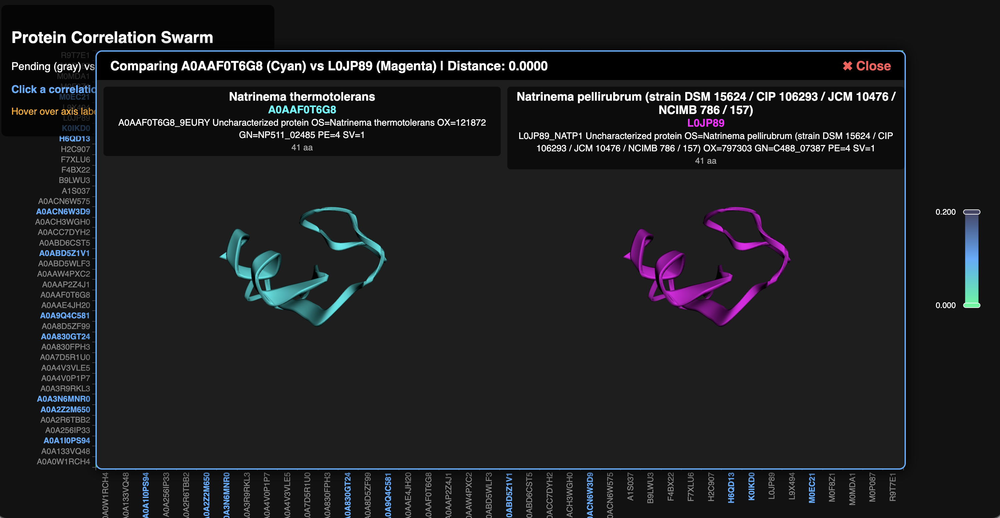

# Protein Correlation Swarm 🧬🦠

Welcome to the **Swarm Discovery** ecosystem! 

Unlike linear discovery scripts that just loop over a static list of keywords, this swarm behaves like a graph-exploration algorithm. It starts with a seed protein and recursively branches out, using vector similarity to find the nearest structural neighbors in the dark proteome across entirely different organisms and ecosystems.

## Components

This example is split into two interoperating scripts:

1. **`swarm_discovery.py`**: The background worker. It pulls "Pending" proteins from the PostgreSQL `orphan_discoveries` table (`FOR UPDATE SKIP LOCKED`), verifies cognate enzyme substrates (`molecules_are_identical`, `mol @> warhead`), vector-searches their top 5 closest evolutionary neighbors via HNSW, computes Layer 8 `interface_complementarity`, Twilight-Zone homology scores, and content-addressable **RosettaCommons Chaperone** lineage hashes (`chaperone_lineage_hash`), marks the original as "Explored", and queues the new neighbors for future exploration.
2. **`swarm_web.py`**: A live visualizer dashboard. It runs a Flask web server that draws an ECharts heatmap representing the pairwise cosine distances between the top nodes in the swarm graph (including **Top 40 Twilight-Zone Discoveries** and **Top 40 Chaperone Biophysical Correlations**).

## Interactive Correlation Wiki & Biophysical Help Center (`📚 Button`)

The web dashboard includes a built-in **Correlation Wiki & Biophysical Help Center** accessible from the top bar (`📚 Correlation Wiki & Help Center`) or by clicking any metric pill inside the 3D comparison modal. It documents all **10 orthogonal correlation layers** evaluated across Swarm discoveries:

| # | Correlation Layer | `pg_bio` SQL / Algorithm | Biological & Biophysical Application |
| :--- | :--- | :--- | :--- |
| **1** | **ESM-2 & Tri-Peptide Vector Homology** | `embedding <=> query`, `embedding_cosine_distance(get_esm_embedding(s1), get_esm_embedding(s2))` | Captures deep fold & active-site semantics across the HNSW graph (`d_cos <= 0.15`). |
| **2** | **Layer 8 PPI Interface Complementarity** | `interface_complementarity(emb1, emb2)` | Splits vectors into electrostatic (anti-correlated) and hydrophobic (positively correlated) subspaces. |
| **3** | **Local Smith–Waterman & BLOSUM62** | `smith_waterman_score(s1, s2, 2, -1, -2)`, `sequence_alignment_score(s1, s2)` | Isolates conserved catalytic cores even when N/C-terminal tails or domain insertions differ. |
| **4** | **Twilight-Zone Discovery Score** | Parabolic score peaking at `15%–35%` SW similarity with tight vector distance | Finds remote cross-genus homologs where BLAST fails (`twilight-40` grid view). |
| **5** | **3D Sequential Kabsch & TM-Score** | Multi-seed internal distance fingerprints + SVD Kabsch + DP (`core_rmsd`, `tm_score`) | Superposes 3D AlphaFold/ESMFold coordinates and verifies global fold conservation (`TM >= 0.50`). |
| **6** | **Chaperone Core RASA Correlation (`r_RASA`)** | `bio_rasa(pdb, 1.4)`, `evaluate_chaperone_block(...)` | 64-point Shrake–Rupley Fibonacci sphere SASA + Tien (2013) normalization; measures solvent exposure conservation. |
| **7** | **Chaperone 3D H-Bond CSR Hubs & BUNS** | `bio_hbond_network(pdb, 3.5)`, `get_top_interacting_residues(...)`, `audit_hydrogen_bonds(...)` | Projects 3D donor–acceptor H-bonds into CSR `SparseAttentionMap` matrices, highlights top 12 structural hubs, and counts Buried Unsatisfied Polar Atoms (`BUNS`). |
| **8** | **Chaperone Surface Hydrophobic Patch & Lineage** | `surface_hydrophobic_fraction`, `chaperone_score`, `chaperone_lineage_hash(...)` | Audits exposed hydrophobic patches (`RASA > 0.25`) for aggregation resistance and assigns deterministic lineage IDs (`chaperone-40` grid view). |
| **9** | **Physicochemical Extremophile Shifts** | `isoelectric_point(seq)`, `gravy_score(seq)`, `sequence_entropy(seq)`, `molecular_weight(seq)` | Tracks halophilic acidic shell adaptation (`Asp/Glu` surface enrichment, `ΔpI`, `ΔGRAVY`). |
| **10** | **Cognate Substrate Cheminformatics & 3D Z-Order** | `molecules_are_identical`, `mol @> warhead` (VF2), `mol % query` (ECFP4), `morton_encode_3d` | Verifies Hückel $4n+2$ aromatic WL64 hashes, reactive catalytic warheads, and 30-bit Morton 3D pocket queries. |
| **11** | **RangeFinder 9-Property Pocket-Interval GiST (`arXiv:2611.03379v1`)** | `predict_pocket_ranges(id, pdb, cx, cy, cz, 10.0)`, `pocket_numranges(p)`, `pocket_range_iou(p1, p2, false)`, `pocket_matches_ligand_8prop(p, lig)` | Extracts 10 Å active-site microenvironments into 9 physicochemical `numrange` intervals (`[μ - 2|σ|, μ + 2|σ|]`), indexes `1,809` AlphaFold pockets via an 8-column PostgreSQL `numrange` GiST index (`swarm_pocket_ranges`), and screens cognate substrates (`rangefinder-40` grid view). |

## Published RangeFinder Pocket-Interval & Cognate Substrate Matches (`swarm_pocket_ranges` $\bowtie$ `orphan_discoveries`)

All **372,367** edges in `orphan_discoveries` are backfilled with Smith–Waterman sequence identity, Twilight-Zone homology scores, and Chaperone lineage hashes, while **1,809** 3D AlphaFold structures are indexed in `swarm_pocket_ranges` (`idx_swarm_pockets_8prop_gist`) and joined against **44** cognate enzyme substrates in `swarm_enzyme_substrates`. Below are the top cross-organism discoveries ranked by composite **RangeFinder Score (`rf_score`)**, combining 8-property active-site interval overlap (`pocket_range_iou`), 8-column `numrange` GiST cognate-substrate containment (`@>`), and ESM-2 interface complementarity:

| Family | Bait Protein (Organism) | Orphan Discovery (Organism) | $d_{\text{cos}}$ | Range-IoU (`8-Prop`) | Substrate Box (`@>`) | Orphan Pocket `MW` Box (Da) | Orphan Pocket `LogP` Box | $P(\text{arom})$ | `rf_score` | Cognate Substrate (`MW`, `LogP`) |
| :--- | :--- | :--- | :---: | :---: | :---: | :---: | :---: | :---: | :---: | :--- |
| **Xylanase** | `A0A2K5ARN2` (*Candidatus Nitrosocaldus cavascurensis*) | `J1L1L0` (*Methanofollis liminatans* DSM 4140) | `0.1472` | **`0.9619`** | **`8/8` ✓** | `[170, 375]` | `[1.36, 5.06]` | `0.911` | **`0.9559`** | Ferulic Acid Arabinoxylan Cross-Link (`194.2 Da`, `2.01`) |
| **Collagenase** | `A0A062V3Q9` (*Candidatus Methanoperedens nitratireducens*) | `M0HS28` (*Haloferax elongans* ATCC BAA-1513) | `0.1443` | **`0.9501`** | **`8/8` ✓** | `[159, 367]` | `[1.08, 4.74]` | `0.846` | **`0.9505`** | *N*-Benzoylglycine / Hippuric Acid (`179.2 Da`, `1.27`) |
| **Hydrogenase** | `A0A7D5TJJ3` (*Halosimplex pelagicum*) | `A0A654LSW6` (*Candidatus Nitrosocosmicus oleophilus*) | `0.1430` | **`0.9472`** | **`8/8` ✓** | `[168, 373]` | `[2.64, 6.66]` | `0.970` | **`0.9493`** | Methyl Viologen / Paraquat Carrier (`170.2 Da`, `3.23`) |
| **Isomerase** | `Q9HMD9` (*Halobacterium salinarum* NRC-1) | `A0A2V2N000` (*Methanospirillum stamsii*) | `0.1500` | **`0.9385`** | **`8/8` ✓** | `[149, 349]` | `[0.25, 3.67]` | `0.815` | **`0.9438`** | Phenylpyruvic Acid Keto-Enol (`164.2 Da`, `1.93`) |
| **PHA synthase** | `A0ABD6DPE4` (*Haloarchaeobius litoreus*) | `A0ABD5Q809` (*Halorussus aquaticus*) | `0.1857` | **`0.9407`** | **`8/8` ✓** | `[148, 348]` | `[0.69, 4.24]` | `0.811` | **`0.9388`** | 3-Hydroxy-3-phenylpropionic Monomer (`166.2 Da`, `2.16`) |
| **Protease** | `M0LJW8` (*Haloarcula japonica* TR-1) | `A0A151A8H2` (*Halalkalicoccus paucihalophilus*) | `0.1673` | **`0.9307`** | **`8/8` ✓** | `[156, 359]` | `[1.06, 4.67]` | `0.910` | **`0.9369`** | *N*-Acetyl-L-tyrosine Amide (`222.2 Da`, `1.69`) |
| **Lipase** | `D2RF45` (*Archaeoglobus profundus* Av18) | `M0HQ78` (*Haloferax elongans* ATCC BAA-1513) | `0.1556` | **`0.9097`** | **`8/8` ✓** | `[168, 376]` | `[0.73, 4.30]` | `0.849` | **`0.9284`** | *p*-Nitrophenyl Acetate (`181.1 Da`, `0.81`) |
| **Amidase** | `A0ACN6W6G1` (*Haloarcula pelagica*) | `W0GHU0` (*Haloarcula hispanica* N601) | `0.1631` | **`0.9112`** | **`8/8` ✓** | `[130, 328]` | `[1.37, 5.07]` | `0.915` | **`0.9279`** | Acetanilide / Paracetamol Amide (`151.2 Da`, `1.73`) |
| **Carboxylesterase** | `A0A2V2N4T4` (*Methanospirillum lacunae*) | `A0A2H5A3K6` (*Haloarcula taiwanensis*) | `0.1492` | **`0.8990`** | **`8/8` ✓** | `[168, 375]` | `[1.23, 4.89]` | `0.923` | **`0.9241`** | *p*-Nitrophenyl Butyrate (`209.2 Da`, `1.59`) |
| **Nitrogenase** | `A0A284VSF6` (*Candidatus Methanoperedens nitratireducens*) | `A0A8T8E7C6` (*Haloterrigena salifodinae*) | `0.0977` | **`0.8728`** | **`8/8` ✓** | `[147, 347]` | `[1.36, 5.04]` | `0.929` | **`0.9198`** | 2-Mercaptobenzoic Acid FeMo-cofactor (`154.2 Da`, `2.32`) |
| **Nitrite reductase** | `A0ABD5M1Y8` (*Halorubrum miltondacostae*) | `A0A6B0T6T3` (*Halovenus carboxidivorans*) | `0.0638` | **`0.9378`** | **`7/8`** | `[171, 377]` | `[1.83, 5.62]` | `0.960` | **`0.9186`** | Phenazine Electron Mediator (`180.2 Da`, `2.99`) |
| **Catalase** | `A0A498KYN8` (*Halorientalis pallida*) | `A0RXU7` (*Cenarchaeum symbiosum* strain A) | `0.1253` | **`0.8510`** | **`8/8` ✓** | `[136, 336]` | `[0.92, 4.45]` | `0.931` | **`0.9042`** | Salicylic Acid Phenolic Donor (`138.1 Da`, `1.59`) |
| **Topoisomerase** | `A0A557STQ6` (*Candidatus Nitrosocosmicus arcticus*) | `L0KYR4` (*Methanomethylovorans hollandica* DMS1) | `0.1401` | **`0.8408`** | **`8/8` ✓** | `[127, 320]` | `[0.42, 3.83]` | `0.922` | **`0.8966`** | Quinolone / Coumarin Gyrase Core (`138.1 Da`, `1.59`) |
| **Glucoamylase** | `A0A2I8VLX9` (*Salinigranum rubrum*) | `L0KYR4` (*Methanomethylovorans hollandica* DMS1) | `0.1272` | **`0.8326`** | **`8/8` ✓** | `[127, 320]` | `[0.42, 3.83]` | `0.922` | **`0.8947`** | 4-Nitrophenyl Glucoside Aglycone (`139.1 Da`, `0.72`) |
| **Alpha-amylase** | `A0A2U9IBL3` (*Acidianus brierleyi*) | `L0KYR4` (*Methanomethylovorans hollandica* DMS1) | `0.1385` | **`0.8353`** | **`8/8` ✓** | `[127, 320]` | `[0.42, 3.83]` | `0.922` | **`0.8941`** | *p*-Nitrophenyl $\alpha$-D-Glucoside (`139.1 Da`, `0.72`) |

## The Dashboard UI

When you run the web server, you will see an interactive heatmap. 
- **Pending nodes** are grayed out.
- **Explored nodes** are highlighted in blue.

You can hover over the X or Y axis labels to instantly see rich biological metadata (Organism name, UniProt ID, sequence length).

**Interactive 3D Comparison:**
If you click on any correlation cell, a modal pops up showing a side-by-side comparison of the two proteins in interactive 3D! The viewers are synchronously linked, meaning if you drag or zoom on one protein, the other will perfectly follow your camera movements in real-time.


*(Example: Finding correlated organisms from completely different ecosystems!)*

## Usage

You'll want to run these two scripts in separate terminal windows (or as background daemon tasks):

### 1. Start the Swarm Agent
```bash
uv run python swarm_discovery.py
```

### 2. Start the Live Web Dashboard
```bash
uv run python swarm_web.py
```
Then, open your browser to **http://localhost:8080** to watch the swarm graph grow!

## Smart Folding Fallback
If the web UI encounters a massive, uncharacterized protein that doesn't exist in the EBI AlphaFold database, it doesn't just crash! It will gracefully intercept the missing file, extract the amino acid sequence from PostgreSQL, and attempt to fold the 3D structure on-the-fly using `pg_bio`'s ESMFold integration. 

If the protein is too massive for your local hardware (e.g. >400 amino acids throwing an `HTTP 413` error), it uses a clever **Domain Chunking** strategy to chop the protein into pieces, fold them, space them out, and stitch them back together into a single unified 3D visualization.
